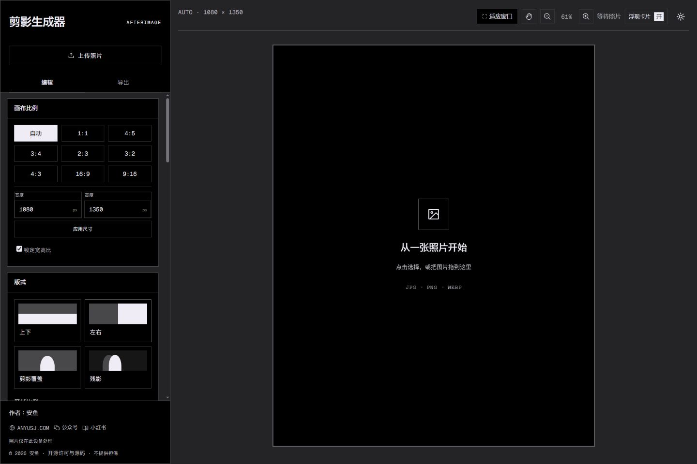
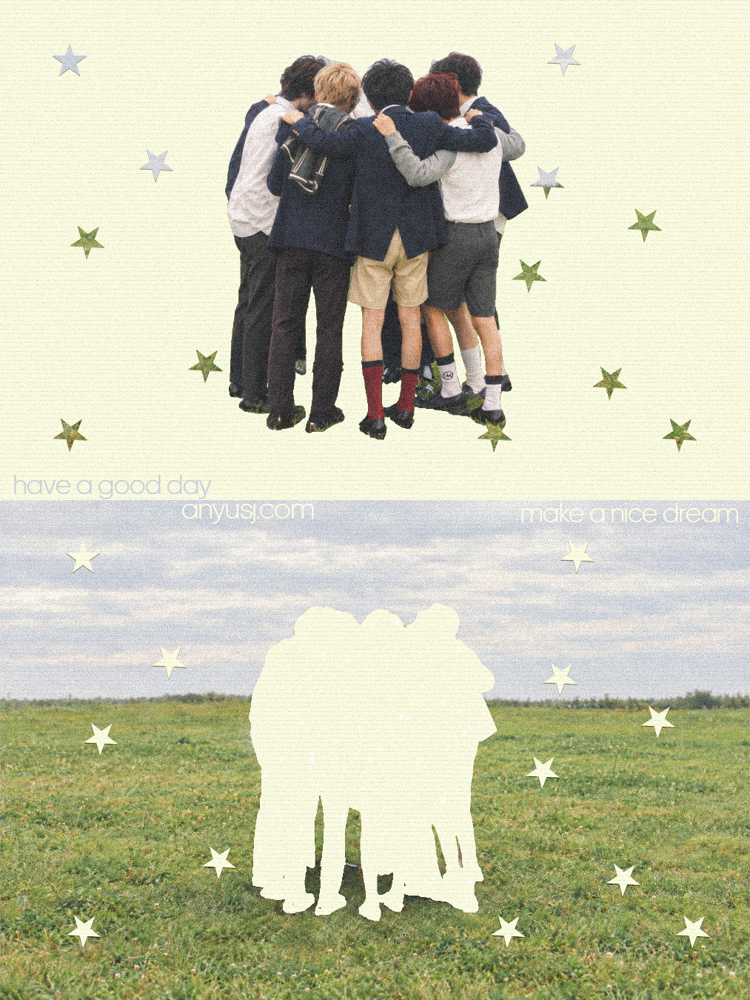
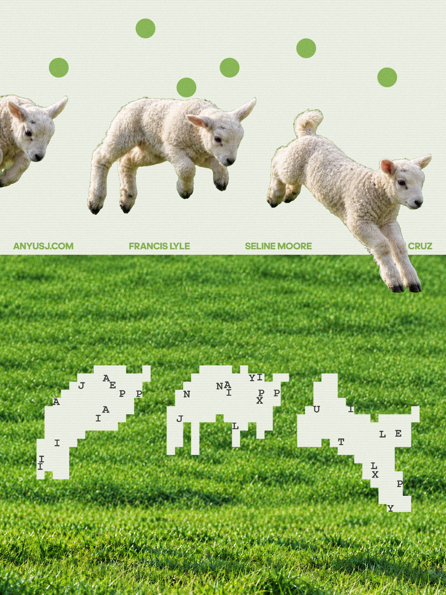
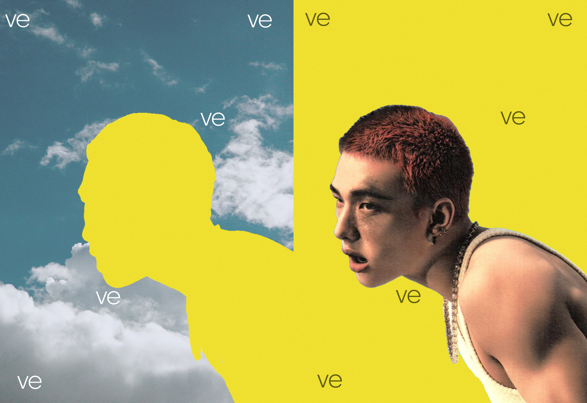
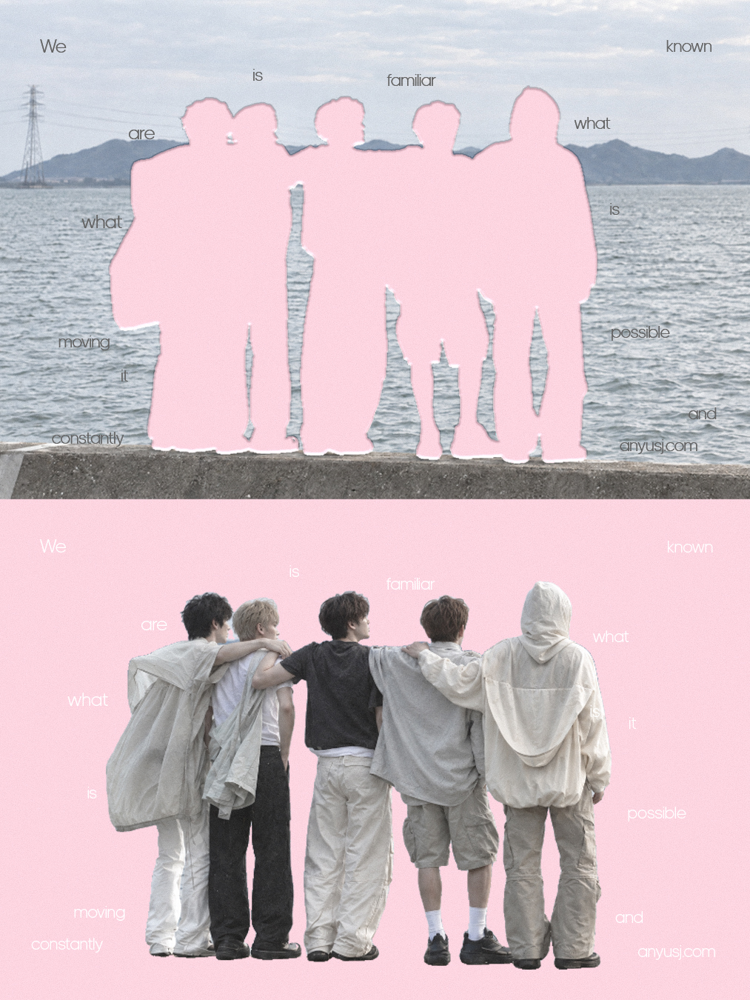
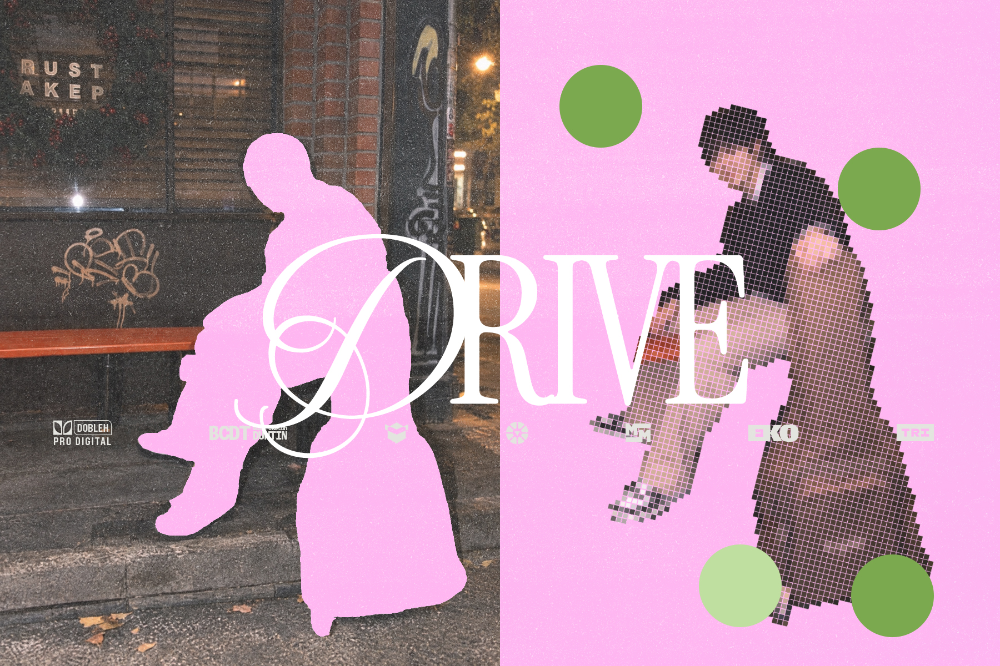

# 剪影生成器 · Silhouette Generator

免费的摄影剪影拼贴工具，直接打开就是编辑器。照片全程在浏览器本地处理，模型与九张背景内置。作者：[安鱼 · ANYUSJ.COM](https://www.anyusj.com/)。

[打开在线工具](https://www886321-commits.github.io/silhouette-generator/) · [下载 v1.3.0 本地安装包](https://github.com/www886321-commits/silhouette-generator/releases/tag/v1.3.0)

## v1.3.0 界面更新

- 每个功能区采用独立卡片，加强作品画布自身边缘；三主题均移除外层画布大框。
- 浅色、米白、深色主题区分工具卡片与工作区；深色为灰色背景、黑色工具卡片与空白画布。
- 颜色选择前增加可编辑 HEX 数值，浮窗和左侧面板同步。
- 画布支持手形按钮、空格/中键平移和鼠标位置缩放，保留适应窗口。
- 轮廓识别阈值实时预览，确认或取消后再导出。
- 小型浮动调整卡片可移动、关闭及开关；剪影和背景的位置/大小仅保留在左侧。
- 修补工具条在页面上部浮动，支持拖动左侧状态区移动，包含目标切换、撤销/重做与完成修补。
- 中文界面、Plix 标题字体、简洁图层图标；保留原来的四种版式示意图。

## 三步上手

1. 上传 JPG/PNG/WebP，自动识别主体并生成剪影。
2. 选上下、左右、剪影覆盖或残影；调整背景、颜色、图层和效果。
3. 左侧点击导出，保存 PNG/JPG/WebP、透明剪影 PNG 或分层 PSD。

## 本地安装：可以交给 AI

在 Releases 下载 **silhouette-generator-v1.3.0-desktop.zip** 并完整解压。将完整包或解压目录交给能操作本机文件的 AI，附上：

> 请按照“本次安装说明.txt”和 AGENT-INSTALL.md 安装这个剪影生成器，检查环境，启动本地网页并验证用户允许的测试照片与 PNG 导出。不要部署公网，不要上传照片。完成后告诉我启动与停止方法。

Windows 双击 `START-WINDOWS.cmd`；Mac/Linux 使用对应 START 文件。需要 Node.js 或 Python；成品无需 npm install。模型、背景和字体已携带，照片处理可离线。不要双击 HTML。

[本次中文 TXT 安装说明](本次安装说明.txt) · [中文 TXT 使用说明](使用说明-中文.txt) · [AI 安装任务书](AGENT-INSTALL.md)

## 主要功能

四层排序与变换、分区整组对调、自定义画布尺寸、原图挖空/图片/纯色背景、半调、像素剪影、散落文字、内外阴影、涂抹修补和纸纹/颗粒。高清导出从原图及独立图层重绘，主题、画布平移缩放、选择框和界面边框不会进入图片。

## 效果示例

## 从源码构建

使用 Node.js 22.12+ 或支持的新版本，运行 `npm ci`、`npm run build`，再运行根目录 START 文件。`public/models` 不可缺失；源码 ZIP 的依赖安装需要联网。Release 包的 `source` 不重复携带模型，重建前将 `app/models` 复制至 `source/public/models`。

## 兼容与许可

推荐桌面新版 Chrome/Edge。Windows Chromium 已验证；Mac/Linux 提供启动脚本，未宣称所有系统实测。手指、发丝和遮挡可能需修补，多人是组合蒙版；PSD 是独立栅格层。没有完整工程保存功能，刷新前先导出。

程序为 [AGPL-3.0-only](LICENSE)，第三方库、字体和背景保留各自许可，见 [第三方声明](THIRD-PARTY-NOTICES.md) 和 licenses。再分发请保留对应源码与许可。
